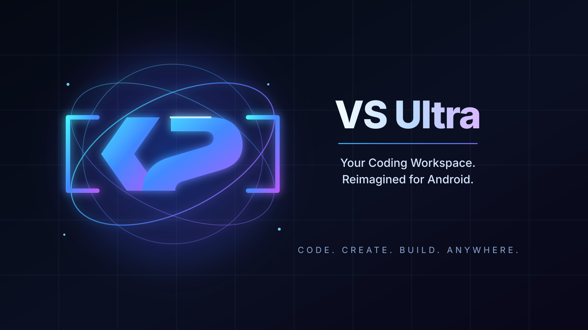
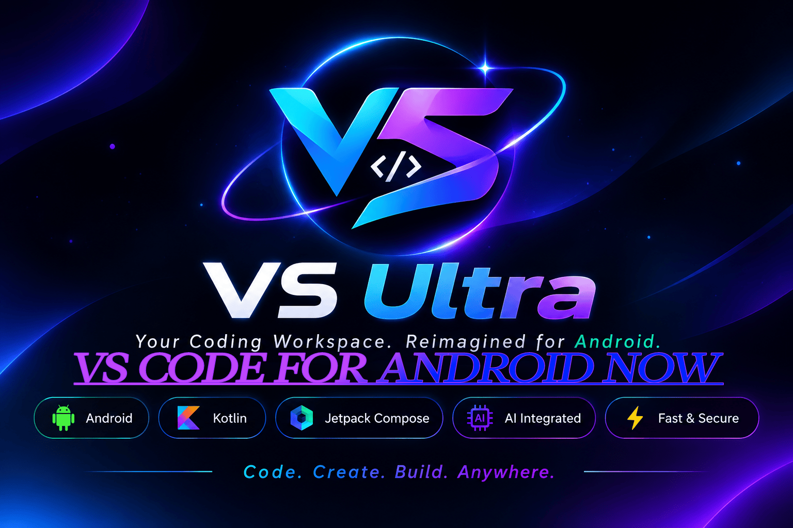

<!--
  VS Ultra project README
  Project documentation is written in English.
-->

<p align="center">
  
</p>

<p align="center">
  
</p>

<h1 align="center">VS Ultra</h1>

<p align="center">
  <strong>Your Coding Workspace. Reimagined for Android.</strong><br>
  A mobile-first Android workspace for connecting to code-server environments, managing code files, and working with Gemini-powered AI assistance.
</p>

<p align="center">
  
  
  
  
  
</p>

---

## Overview

**VS Ultra** is an Android application built around a practical mobile coding workflow. It brings web-based development environments into an in-app workspace and combines them with local code-file management, saved server profiles, an integrated terminal-style activity console, and Gemini AI assistance.

The application can work with a built-in localhost workspace, a Termux-based code-server setup, or a user-configured remote/cloud IDE URL. Its interface is implemented with Kotlin and Jetpack Compose.

> **Project naming note:** The repository is branded as **VS Ultra**, while the current Android application label and several internal identifiers still use **VS Shell**. This README documents the repository as VS Ultra without implying that those internal identifiers have already been renamed.

## Features

### In-app coding workspace
- Embedded Android WebView workspace for opening configured IDE and code-server URLs.
- Built-in localhost HTTP workspace for managing a lightweight project workspace from the app.
- Support for saved server profiles, active/pinned profiles, and custom server URLs.
- Workspace loading, connection status, retry, and error states.
- Optional desktop-mode browsing and developer shortcut controls.
- External browser handoff is presented for user approval rather than opened automatically.

### Localhost and Termux workflow
- Built-in localhost server bound to the loopback interface.
- Termux integration flow for preparing or opening a Termux code-server command.
- Local workspace folders and starter-file support.
- Background keep-alive and watchdog services for monitoring an active localhost session.
- Health probes, restart tracking, and exponential backoff to reduce repeated restart loops.

### Phone file manager and editor
- App-managed phone workspace with an option to link a folder through Android's Storage Access Framework.
- Create, import, open, edit, save, and delete code files.
- Search and filter files by language.
- Save a file and send it to the active VS Code/code-server workspace.
- Language-aware file types and starter templates currently defined for:
  - Python
  - TypeScript
  - JavaScript
  - Kotlin
  - Java
  - HTML
  - CSS
  - JSON
  - C / C++
  - Shell
  - Markdown
  - Plain text and other files

### Gemini AI assistant
- Integrated Gemini coding chat with selectable role presets.
- Streaming responses, retry handling, cancellation, and conversation history.
- AI-assisted localhost workspace bootstrap and code-edit workflows.
- Structured code-edit responses can include a primary file and additional files.
- Firebase AI Logic integration with a primary model identifier and a compatibility fallback.

AI availability depends on a correctly configured Firebase project, supported model access, and valid App Check configuration. Model availability and quotas are controlled by the configured provider.

### Server profiles and account workflow
- Create, edit, pin, activate, and remove server profiles.
- Store server connection details and optional credential hints.
- In-app GitHub sign-in page flow.
- Optional master credential vault for supported profile autofill workflows.

### Themes and app controls
- VS Code Dark+
- Tokyo Night
- Dracula
- VS Code Light
- High Contrast
- Material You / system dynamic colors
- Immersive workspace mode, keep-screen-awake control, and developer shortcut bar.
- Optional app PIN lock and Screen Privacy Shield.
- Cookie/cache clearing and diagnostic-log export/share controls.

## Screens

The current app navigation exposes these primary areas:

| Screen | Purpose |
| --- | --- |
| **Servers** | Manage saved IDE and code-server profiles. |
| **Phone Files** | Browse, create, edit, import, and manage code files on the device. |
| **AI Chat** | Interact with the Gemini coding assistant. |
| **Settings** | Configure themes, background behavior, privacy, and diagnostics. |
| **Workspace** | Open the selected IDE or localhost coding environment inside the app. |

## Technology Stack

| Component | Implementation |
| --- | --- |
| Primary language | Kotlin |
| Android UI | Jetpack Compose, Material 3 |
| Web workspace | Android WebView and AndroidX Browser / Custom Tabs support |
| Asynchronous work | Kotlin Coroutines and Flow |
| Local database | Room |
| Preferences | Jetpack DataStore |
| AI integration | Firebase AI Logic |
| App attestation | Firebase App Check |
| Credential protection | Android Keystore, AES-GCM, PBKDF2-SHA256 |
| Build system | Gradle Kotlin DSL, Version Catalog, Android Gradle Plugin |
| Tests | JUnit, Robolectric, AndroidX test libraries |

## Architecture at a Glance

The codebase is organized into feature-oriented packages under `app/src/main/java/com/example`:

- `ai/` — Gemini AI service and generation workflows.
- `data/local/` — Room database and DAO interfaces.
- `data/model/` — application data models and language definitions.
- `data/repository/` — settings, server-profile, and phone-file data access.
- `security/` — credential encryption, PIN verification, and URL/log sanitization helpers.
- `service/` — foreground keep-alive and localhost watchdog services.
- `terminal/` — terminal-style log buffer and ANSI span parsing.
- `ui/components/` — reusable interface components.
- `ui/screens/` — workspace, files, profiles, AI chat, and settings screens.
- `ui/theme/` — color schemes, typography, and theme presets.
- `ui/viewmodel/` — screen state and UI coordination.
- `workspace/` — WebView controller, localhost server engine, and runtime coordination.

## Security and Privacy

The repository includes several application-level safeguards:

- **Credential encryption:** stored secrets are wrapped with AES-GCM using an Android Keystore key when encryption succeeds.
- **PIN protection:** the app PIN verifier uses a salted PBKDF2-SHA256 hash.
- **Localhost API protection:** the built-in server uses a per-session token, loopback host/origin validation, request-size limits, and confined file paths.
- **Preview isolation:** generated HTML previews use a sandboxed iframe and a restrictive Content Security Policy.
- **WebView hardening:** unsafe URL schemes and cross-host credential autofill are restricted; file/content access and mixed content are disabled in the configured workspace WebView.
- **Network policy:** the network security configuration is intended to require HTTPS for remote traffic while permitting loopback HTTP for local development.
- **Screen privacy:** an optional privacy shield can use Android's secure-window flag.
- **Diagnostics:** diagnostic logging includes URL and sensitive-text redaction helpers.

Security behavior depends on Android version, device implementation, configuration, and the exact code path used. Review the implementation and test it on target devices before relying on it for sensitive production workloads. The safeguards described here are not a substitute for an independent security audit.

## Requirements

The current Gradle configuration specifies:

- Android **minimum SDK 24** (Android 7.0).
- Android **compile SDK 36**.
- Android **target SDK 36**.
- Java source and target compatibility **11**.
- A compatible Android SDK installation and the JDK required by the configured Android Gradle Plugin.

Some workflows additionally require:
- **Termux**, if you choose the external Termux-based code-server route.
- A reachable code-server or IDE URL, if connecting to a remote workspace.
- A configured **Firebase project** with the required AI Logic and App Check setup, if using Gemini features.

## Getting Started

### 1. Clone the repository

```bash
git clone https://github.com/avirupgaming59-hue/Vs-ultra.git
cd Vs-ultra
```

### 2. Configure Firebase (for AI features)

Connect the project to your own Firebase Android app and provide the Firebase configuration required by the Google Services and Firebase AI Logic plugins. Configure App Check for your development and production environments.

Do not commit private credentials, signing keys, service-account files, or local environment files. Keep secrets in local environment variables or GitHub Actions secrets.

### 3. Build a debug APK

Make sure the Android SDK and required SDK packages are installed, then run:

```bash
./gradlew :app:assembleDebug
```

The debug APK is normally generated at:

```
app/build/outputs/apk/debug/app-debug.apk
```

### 4. Run unit tests

```bash
./gradlew :app:testDebugUnitTest
```

To run connected Android tests, attach or start a compatible Android device/emulator and run:

```bash
./gradlew :app:connectedDebugAndroidTest
```

These commands document the available build/test workflow; they do not imply that every task has already been executed successfully on every device.

## Release Builds

The repository includes a GitHub Actions workflow at `.github/workflows/release-apk.yml`.

The workflow is configured to run on pushes to `main` and can also be started manually from the Actions tab. It builds a signed release APK and publishes it as a GitHub Release.

Before the workflow can publish a signed APK, configure these repository Actions secrets:

| Secret | Description |
| --- | --- |
| `KEYSTORE_BASE64` | Base64-encoded upload keystore file. |
| `STORE_PASSWORD` | Keystore password. |
| `KEY_PASSWORD` | Password for the `upload` key alias. |

See [RELEASE_GUIDE.md](RELEASE_GUIDE.md) for the complete signing and release procedure.

**Important:** Keep the keystore and passwords private. Losing the upload key may prevent future updates signed with the same key.

## Repository Structure

```text
.
├── .github/
│   └── workflows/
│       └── release-apk.yml
├── app/
│   ├── src/
│   │   ├── androidTest/
│   │   ├── main/
│   │   │   ├── java/com/example/
│   │   │   ├── res/
│   │   │   └── AndroidManifest.xml
│   │   └── test/
│   ├── build.gradle.kts
│   └── proguard-rules.pro
├── assets/
│   ├── Picsart_26-11-25_21-12-57-169.png
│   └── vs-ultra-hero.svg
├── gradle/
│   ├── wrapper/
│   └── libs.versions.toml
├── RELEASE_GUIDE.md
├── build.gradle.kts
├── gradle.properties
├── settings.gradle.kts
└── walkthrough.md
```

## Testing and Verification

The project contains local unit tests and Android test sources. The unit-test suite includes coverage for areas such as:

- Localhost port detection and server lifecycle behavior.
- Gemini model selection, retry policy, and backoff behavior.
- Localhost request authentication, host/origin checks, and path confinement.
- Secure-vault encryption/decryption and PIN verification.
- URL scheme filtering and WebView credential-autofill restrictions.
- Startup diagnostics and related helper behavior.

Run the test commands above in an appropriately configured Android build environment and review the output before treating a build as release-ready.

## Current Project Status

VS Ultra is an actively developed Android project. The repository contains a working implementation of the screens and supporting services described above, together with tests and a signed-release workflow definition. Build success, Firebase configuration, AI model access, and device-specific behavior should be verified in the environment where you intend to use or distribute the app.

## Contributing

Contributions, bug reports, and focused improvements are welcome. Before opening a pull request:

1. Describe the problem or feature clearly.
2. Keep changes scoped and consistent with the existing Kotlin/Compose architecture.
3. Run the relevant unit tests.
4. Avoid committing secrets, signing material, generated build output, or private user data.
5. Update this README or the relevant technical documentation when behavior changes.

## License

VS Ultra is distributed under a **proprietary, source-available, all-rights-reserved license**. See [LICENSE](LICENSE) for the full terms.

The license does not grant general permission to copy, modify, redistribute, incorporate, or commercially exploit project-owned materials. Prior written permission from the copyright holder is required for those activities, subject to applicable law and any separate licenses covering third-party materials.

**Important:** A repository license cannot technically prevent copying or GitHub forking, and it cannot require GitHub to automatically close another repository. GitHub reviews copyright complaints under its own policies. Any enforcement request must identify actual allegedly infringing material and be truthful and properly supported.

---

<p align="center">
  <strong>Code. Create. Build. Anywhere.</strong>
</p>
